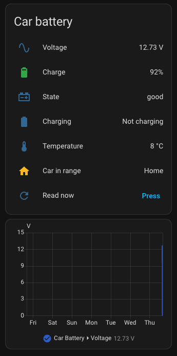
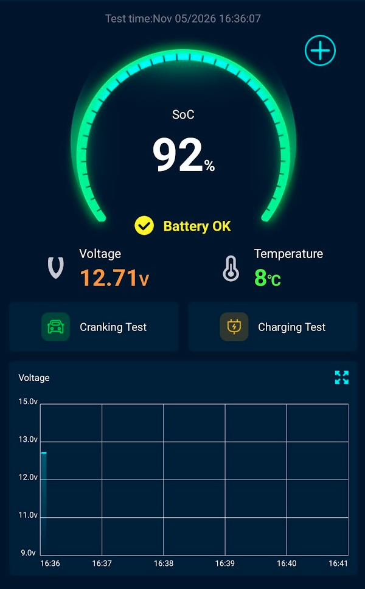
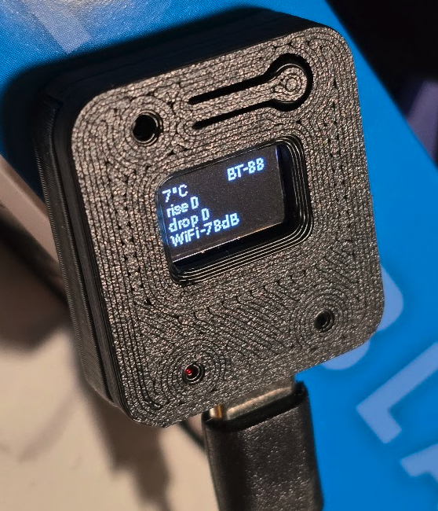

My car is a Hyundai Ioniq 5. Like most EVs, it still has an ordinary 12 V battery, and that battery decides whether the car wakes up at all. If it's flat, a full high-voltage pack doesn't help: the car won't go into ready mode. The 12 V battery is charged from the high-voltage pack, so a problem on that side can drain it without warning. I want to know the 12 V voltage every day, not only when the car refuses to start.

I already had an [intAct Battery Guard](https://www.amazon.de/dp/B00ZETXNAQ) on the battery. It's a Bluetooth monitor that reports to a phone app, but only while you're standing next to the car with the app open. The solution is an ESP32 board in the garage that reads the Battery Guard over Bluetooth and sends the data to Home Assistant through ESPHome.

Full source: [github.com/artosalminen/esp32-battery-guard](https://github.com/artosalminen/esp32-battery-guard)



## Hardware

- [intAct Battery Guard](https://www.amazon.de/dp/B00ZETXNAQ). It clamps onto the battery terminals. Internally it's a BM6, the same device sold as ANCEL BM200, Sealey BT2020 and others, so this should work with any of them.
- [ESP32-C3 board with a 0.42" OLED](https://www.amazon.de/dp/B0FWK7N67Y). It's the same board design as in my [darts lights post](): a 72x40 SSD1306 on I2C, with a BOOT button on GPIO9.
- A USB-C charger in the garage, within Bluetooth range of the car.

No wiring. The board just needs power.

## Talking to the Battery Guard

The BM6 protocol has been reverse engineered by [Waldmensch1/BatteryGuard](https://github.com/Waldmensch1/BatteryGuard) (PlatformIO + MQTT) and [tarball.ca](https://www.tarball.ca/posts/reverse-engineering-the-bm6-ble-battery-monitor/). I ported it to ESPHome, so there's no MQTT broker and Home Assistant discovers the device on its own.

Every frame is 16 bytes, encrypted with AES-128-CBC with a zero IV and a static key that's the same for every BM6. You write commands to characteristic `FFF3` and get readings back as notifications on `FFF4`. After a six-write handshake, the device sends a frame about once a second:

| Byte | Field |
|------|-------|
| 0–2  | header `D1 55 07` |
| 3–4  | temperature (byte 3 = sign) |
| 5    | status, `02` = charging |
| 6    | state of charge, % |
| 7–8  | voltage × 100, big-endian |
| 9–12 | voltage rise/drop event counters |

The decryption lives in a small header, `bm6.h`, using mbedtls, which ships with ESP-IDF. The `ble_client` sensor hands each notification to it:

```yaml
sensor:
  - platform: ble_client
    type: characteristic
    ble_client_id: bm6_client
    service_uuid: "FFF0"
    characteristic_uuid: "FFF4"
    notify: true
    update_interval: never
    internal: true
    lambda: |-
      bm6::Reading r;
      if (!bm6::parse(x, r)) return NAN;   // handshake acks etc.
      if (r.voltage < 1.0f) return NAN;    // first frame after handshake is all zeros
      id(bm_voltage) = r.voltage;
      id(bm_soc) = r.soc;
      // ... temperature, status, counters
      id(bm_last_ms) = millis();
      return r.voltage;
```

Template sensors publish the stored values to Home Assistant, so the recorder doesn't get a sample every second.

## Don't hold the connection

My first version stayed connected all the time. It worked, but it had two problems. The Battery Guard accepts only one connection, so the phone app stopped working. And the monitor sits on the battery I'm trying to protect, so constant radio traffic was a cost I didn't want.

Now the board connects every 15 minutes, takes one valid reading and disconnects. That holds the link for about 3 seconds per cycle:

```yaml
ble_client:
  - mac_address: !secret bm6_mac
    id: bm6_client
    auto_connect: false

script:
  - id: read_cycle
    mode: single
    then:
      - lambda: id(cycle_start_ms) = millis();
      - ble_client.connect: bm6_client
      - wait_until:
          condition:
            lambda: return id(bm_last_ms) != 0 && id(bm_last_ms) - id(cycle_start_ms) < 0x80000000u;
          timeout: 60s
      - ble_client.disconnect: bm6_client

interval:
  - interval: 15min
    then:
      - script.execute: read_cycle
```

The handshake is sent from `on_connect`. If two cycles in a row get nothing, the sensors go `unknown` instead of showing an old voltage. A `Car In Range` binary sensor shows whether the last cycle reached the car, which doubles as a "car is home" sensor. Between cycles, the intAct app connects normally:



The app and Home Assistant agree: 92 %, 12.7 V, 8 °C.

## The display and the button

The OLED shows the state of charge, the voltage in large digits, a charge bar and how many minutes old the reading is. The voltage is inverted while the battery is being charged.

A short press on BOOT takes a reading immediately. A long press shows a details screen for five seconds: temperature, Bluetooth signal to the Battery Guard, the rise/drop counters and WiFi signal:



`BT-88` is the signal in dBm through the car body and a garage wall. That's close to the limit, but it works. Both radios run at full power, and BLE at +20 dBm instead of the ESP-IDF default +9:

```yaml
esp32:
  framework:
    type: esp-idf
    sdkconfig_options:
      CONFIG_BT_CTRL_DFT_TX_POWER_LEVEL_P20: y
wifi:
  output_power: 20.5dB
```

## Alerting

A reading every 15 minutes doesn't help unless something tells you when it's bad. This automation notifies when the resting voltage stays below 12.2 V for 30 minutes, which is around 50 % for a lead-acid battery. The 30 minutes means two consecutive low readings, so a single dip doesn't trigger it:

```yaml
alias: Car battery low
triggers:
  - trigger: numeric_state
    entity_id: sensor.car_battery_voltage
    below: 12.2
    for:
      minutes: 30
conditions:
  - condition: state
    entity_id: binary_sensor.car_battery_charging
    state: "off"
actions:
  - action: notify.mobile_app_YOUR_PHONE
    data:
      title: "Car battery low"
      message: "{{ states('sensor.car_battery_voltage') }} V"
```

For the Ioniq 5, the history graph is as useful as the alert. A battery that drops a little every night, and never gets topped back up, points at the car's charging side, not at the battery itself.

## Gotchas

**The first data frame is all zeros.** In always-connected mode the next frame overwrote it a second later, so I never noticed. In poll mode, that zero frame was the only reading of the cycle, and Home Assistant got a 0.00 V "critical" value. The fix is to reject frames with a voltage below 1 V.

**Entity IDs can include the area.** After I put the device in an area, entities added later got the area as a prefix (`binary_sensor.<area>_car_battery_...`), while the older ones kept the plain `car_battery_` prefix. If a card says "Entity not found", check the real IDs on the device page.

**Docker on macOS can't reach USB.** I build with the ESPHome Docker image, so nothing gets installed on the Mac. A container can't flash over USB on macOS, though. For the first flash, take the `firmware.factory.bin` from the build and flash it at [web.esphome.io](https://web.esphome.io). After that, OTA from the container works fine.

## Result

The 12 V voltage is in Home Assistant every 15 minutes, with a week of history and a notification if it gets low. The garage display shows the same number at a glance, and the phone app still works. Configuration, flashing instructions and the dashboard card are in the [repository](https://github.com/artosalminen/esp32-battery-guard).
